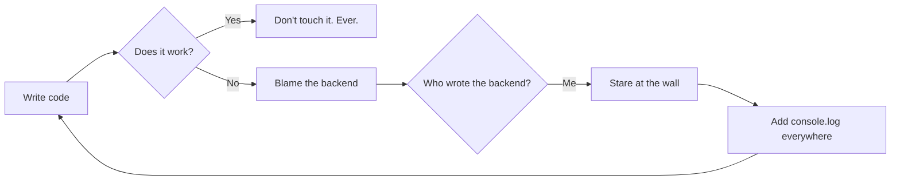

<p align="center">
  
</p>

<p align="center">
  <a href="https://www.gaurav-sharma.in"></a>
  <a href="https://www.linkedin.com/in/gauravsharma12"></a>
  <a href="mailto:gauravsharma.dev@outlook.com"></a>
</p>

<p align="center">
  
  
  
  
  
</p>

<p align="center">
  
</p>

## 🧑‍💻 About me (the honest version)

| What my resume says | What it actually means |
| --- | --- |
| **MERN Full-Stack Developer** | I build the frontend, then the backend, then blame one for the other. |
| **Flutter Developer Intern @ HRanker** | Shipped EdTech apps with courses, videos and quizzes. The quiz grades you. I don't. |
| **AI Trainee @ Garage Collective** | Built an AI agent that writes daily social posts and cut content work by ~40%. It's more consistent on LinkedIn than I am. |
| **B.Tech CSE @ JECRC (2022–2026)** | Learned that "it compiles" and "it works" are two very different emotions. |
| **Username: iblamethebackend** | It's a lifestyle, not a bug. |

```js
const gaurav = {
  location: "localhost:3000",
  languages: ["JavaScript", "TypeScript", "Dart", "Sarcasm"],
  currentlyLearning: "how to center a div without googling it (day 1,284)",
  askMeAbout: ["React", "Node.js", "Flutter", "making LLMs return valid JSON"],
  realCommitMessages: ["some changes", "New change idk what"], // actual history, look it up
};
```

## 🛠️ Things I break professionally

<p align="center">
  
  <br>
  
</p>

<p align="center">
  <b>AI corner:</b>
  
  
  
  
  
</p>

## 🚀 Stuff that actually shipped (and still runs, mostly)

<table>
  <tr>
    <td width="50%" valign="top">
      <h3>📊 Atlass CRM</h3>
      <p>A CRM where you drag deals across a Kanban board until they <i>feel</i> closed. Groq AI reads your pipeline and gives insights, so now even the data judges you.</p>
      <p><code>React 19</code> <code>Express</code> <code>MongoDB</code> <code>dnd-kit</code> <code>Groq</code></p>
      <p><a href="https://thecrm-frontend.onrender.com">Live demo</a> · <a href="https://github.com/iblamethebackend/TheCRM">Code</a> · <a href="https://www.gaurav-sharma.in/projects/atlass-crm">Case study</a></p>
    </td>
    <td width="50%" valign="top">
      <h3>🎯 HireMate</h3>
      <p>Paste your resume and a job description. Gemini tells you exactly what you're missing, then hands you a prep plan and interview questions. Emotional support sold separately.</p>
      <p><code>React</code> <code>Express</code> <code>Gemini</code> <code>Zod</code> <code>JWT</code></p>
      <p><a href="https://hire-mate-rouge.vercel.app">Live demo</a> · <a href="https://github.com/iblamethebackend/HireMate">Code</a> · <a href="https://www.gaurav-sharma.in/projects/hiremate">Case study</a></p>
    </td>
  </tr>
  <tr>
    <td width="50%" valign="top">
      <h3>💬 PingChat</h3>
      <p>Real-time chat with Socket.IO, Clerk auth and image uploads. Messages arrive instantly. Replies from your friends are not my responsibility.</p>
      <p><code>React</code> <code>Socket.IO</code> <code>MongoDB</code> <code>Clerk</code> <code>Zustand</code></p>
      <p><a href="https://chat-app-6oi7.onrender.com">Live demo</a> · <a href="https://github.com/iblamethebackend/chat-app">Code</a> · <a href="https://www.gaurav-sharma.in/projects/pingchat">Case study</a></p>
    </td>
    <td width="50%" valign="top">
      <h3>🤖 AI Content Agent</h3>
      <p>Built at Garage Collective. Writes daily Instagram, LinkedIn and blog drafts and cut manual content work by roughly 40%. Humans still approve every post. For now.</p>
      <p><code>Gemini</code> <code>n8n</code> <code>Node.js</code> <code>Zod</code></p>
      <p><a href="https://www.gaurav-sharma.in/blog/ai-content-agent-gemini-n8n">How it works</a></p>
    </td>
  </tr>
</table>

<p align="center"><sub>Demos on Render's free tier take a moment to wake up. They're not broken, they're just like me before coffee.</sub></p>

## 🔁 My development cycle



## ✍️ I also write things (on purpose)

- 🧩 [Building a drag-and-drop Kanban board with dnd-kit, Express and MongoDB](https://www.gaurav-sharma.in/blog/react-kanban-dnd-kit-express-mongodb)
- ⚡ [Real-time chat with Socket.IO, Express and MongoDB](https://www.gaurav-sharma.in/blog/socketio-realtime-chat-express-mongodb)
- 🧠 [Getting reliable JSON out of Gemini with Zod](https://www.gaurav-sharma.in/blog/gemini-structured-output-zod)
- 🤖 [How to build an AI content agent with Gemini and n8n](https://www.gaurav-sharma.in/blog/ai-content-agent-gemini-n8n)
- 📱 [Provider vs Bloc in Flutter: when I use each](https://www.gaurav-sharma.in/blog/flutter-provider-vs-bloc-mvvm)

## 🐍 A snake eating my contributions

<p align="center">
  <picture>
    <source media="(prefers-color-scheme: dark)" srcset="https://raw.githubusercontent.com/iblamethebackend/iblamethebackend/output/snake-dark.svg">
    
  </picture>
</p>

<p align="center"><sub>It's not lazy. It's eating the green squares so you can't count them.</sub></p>

## ❓ Frequently asked questions

<details>
<summary><b>Is it really always the backend?</b></summary>
<br>
Statistically, no. Emotionally, yes.
</details>

<details>
<summary><b>Why "iblamethebackend" if you also write backends?</b></summary>
<br>
Because accountability is a backend concern.
</details>

<details>
<summary><b>Can you build my app?</b></summary>
<br>
Yes. Web apps, Flutter apps, AI agents and automations. Real answers (no sarcasm, promise) at <a href="https://www.gaurav-sharma.in/services">gaurav-sharma.in/services</a>.
</details>

<details>
<summary><b>Do you use AI to write code?</b></summary>
<br>
I use AI the way you use Stack Overflow: confidently, and then I read the code anyway.
</details>

## 🤝 Hire me (I promise the backend is fine)

Open to **freelance and full-time** work: MERN web apps, Flutter apps, AI agents and automation.

<p align="center">
  <a href="https://www.gaurav-sharma.in/services"></a>
  <a href="mailto:gauravsharma.dev@outlook.com"></a>
</p>

<p align="center"><sub>Works on my machine. Ships on yours. 🚀</sub></p>
